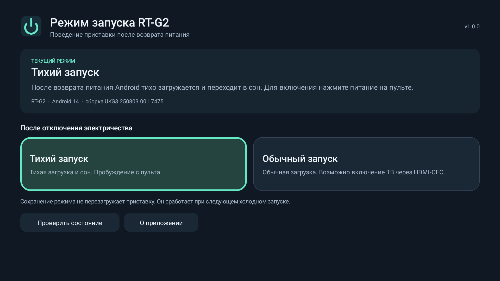

# RT-G2 Power Control

[Русская инструкция](README.ru.md)

An Android TV app for choosing how a **RockTek RT-G2** starts when mains power returns.



- **Quiet start:** Android boots quietly and enters sleep. Wake the box with the remote; normal HDMI-CEC wake remains available.
- **Normal start:** restore the reviewed original startup script. The box may turn on the TV through HDMI-CEC.
- TV launcher banner and icon, D-pad navigation, Russian and English UI.
- No root, Internet permission, background service, or automatic reboot.
- Saving requires on-screen confirmation, an original-script backup, and readback verification.

Quiet start still boots Android before it sleeps. It does **not** prevent the processor from starting when power is supplied.

## Compatibility

Version 1.0 is deliberately limited to this exact verified firmware:

| Item | Supported value |
| --- | --- |
| Model | RockTek RT-G2 / SEI804RT / YYJ |
| Android | Android TV 14 |
| Firmware | 7475 / `UKG3.250803.001.7475` |
| Fingerprint | `RockTek/SEI804RT/YYJ:14/UKG3.250803.001/7475:user/release-keys` |

The current `switch_bootmode` must also match either the exact reviewed original or this app’s exact quiet-start profile. Other devices, firmware builds, and unexpected scripts are read-only/unsupported. Do not remove these checks to try the app on a similar box. Additional profiles need their own analysis and hardware tests.

## Install and use

1. Download the **release APK** from [Releases](https://github.com/ravextech/rtg2-power-control/releases/latest).
2. Transfer it to the box and open it with an APK installer, or install with ADB:

   ```sh
   adb install -r RTG2-Power-Control-1.0.0.apk
   ```

3. Open **RT-G2 Power Control** in the TV’s app list (Russian name: **Режим запуска RT-G2**).
4. Choose Quiet start or Normal start, then confirm **Save mode**.
5. The box does not restart immediately. Test later by turning the TV off, removing the box’s power for 10 seconds, reconnecting it, and waiting for Android to finish booting. Then check that Power on the box remote wakes it normally.

You only need ADB for optional installation; opening the app and switching modes work entirely on the box.

## Restore normal startup

Open the app, select **Normal start**, and confirm. This restores the embedded reviewed original script after checking the current firmware and script. The app verifies the result before reporting success.

Uninstalling the APK does **not** reset bootenv. Restore Normal start first if you want to remove the behavior. Keep the signed APK so it can be reinstalled for restoration. If an error occurs during saving, keep power connected and inspect the error before rebooting. Firmware updates may reset the setting or make the profile unsupported.

## How it works

The app loads the firmware’s optional `droidlogic.software.core` library and uses `com.droidlogic.app.SystemControlManager` through reflection. The firmware’s SELinux policy permits this vendor API for ordinary app processes, even though it denies the same service to an ADB shell process. This is device-specific vendor behavior, not a generic Android API.

Only `ubootenv.var.switch_bootmode` is written. The quiet profile changes one branch:

```diff
 else if test ${reboot_mode} = cold_boot; then
+    setenv bootconfig ${bootconfig} androidboot.quiescent=1;
+    setenv vout_init enable;
     run try_auto_burn;
```

These commands already exist in the same firmware’s stock `quiescent` branch. Recovery, update, fastboot, and other branches are retained. No bootloader image, system partition, boot image, or SELinux policy is flashed or patched by the APK.

The firmware’s Android framework recognizes `ro.boot.quiescent=1`, sleeps after boot, and suppresses normal boot-time HDMI-CEC activation. The app reads back the complete script after saving. A private backup of the reviewed original is synced to app storage before the first write; the same original is also embedded in the APK for reinstalls.

The exported launcher activity ignores mode-changing intent extras. All mode changes originate from the app’s confirmation dialog.

## Verification

The startup profile was verified on physical RT-G2 hardware with build 7475 on **2026-11-19**: after a power disconnect/reconnect the TV remained off; the box entered quiescent sleep; the remote woke the box and TV; the script persisted. Observed properties: `ro.boot.bootreason=cold_boot`, `ro.boot.quiescent=1`, and `mLastSleepReason=quiescent`.

The GUI release is additionally checked on that device for TV launcher visibility, D-pad interaction, cancellation, read-only refresh, and mode changes in both directions. These observations cover the tested box and firmware, not every unit or future OTA.

The controller’s host tests cover firmware gating, script identity, the exact patch boundary, backup failure, readback failure, stale state, idempotency, restore, and refusal of invalid profiles. See [tests](tests/BootModeControllerTest.java).

## Build

Requires **JDK 17+**, **Python 3.9+**, and macOS or x86-64 Linux. On Windows use WSL. No global Android SDK or Gradle installation is needed. The script downloads pinned Google/Android build tools and checks SHA-256 hashes. It downloads no vendor firmware.

```sh
python3 tools/build.py --test-only
python3 tools/build.py
```

The second command produces a locally debug-signed APK in `build/`. GitHub Actions also builds a debug-signed artifact; install the signed **Release** for normal use. Different signing keys cannot update each other in place.

To build a release with your own private key:

```sh
python3 tools/build.py --release \
  --keystore /private/path/release.p12 \
  --password-file /private/path/password.txt \
  --alias release
```

Keep the key and password file outside the repository. The published release signing key is not included. To select a JDK set `JAVA_HOME`; to relocate the verified tool cache set `RTG2_BUILD_CACHE`.

Artwork is original geometric artwork. The committed PNGs are ready to build; optional regeneration uses Pillow and a font you provide:

```sh
python3 tools/generate_assets.py --font /path/to/font.ttf
```

## References

- [Android TV launcher requirements](https://developer.android.com/training/tv/get-started/create)
- [Android TV D-pad navigation](https://developer.android.com/training/tv/get-started/navigation)
- [Android PowerManagerService quiescent handling](https://android.googlesource.com/platform/frameworks/base/+/refs/heads/android14-release/services/core/java/com/android/server/power/PowerManagerService.java)
- [OTA metadata for the reviewed target firmware](https://otachecker.com/ota/1887)

## License

Original app code, tests, and artwork: [MIT](LICENSE). This is an independent project and is not affiliated with RockTek or SEI Robotics. No vendor library, firmware image, or signing key is distributed in this repository.
