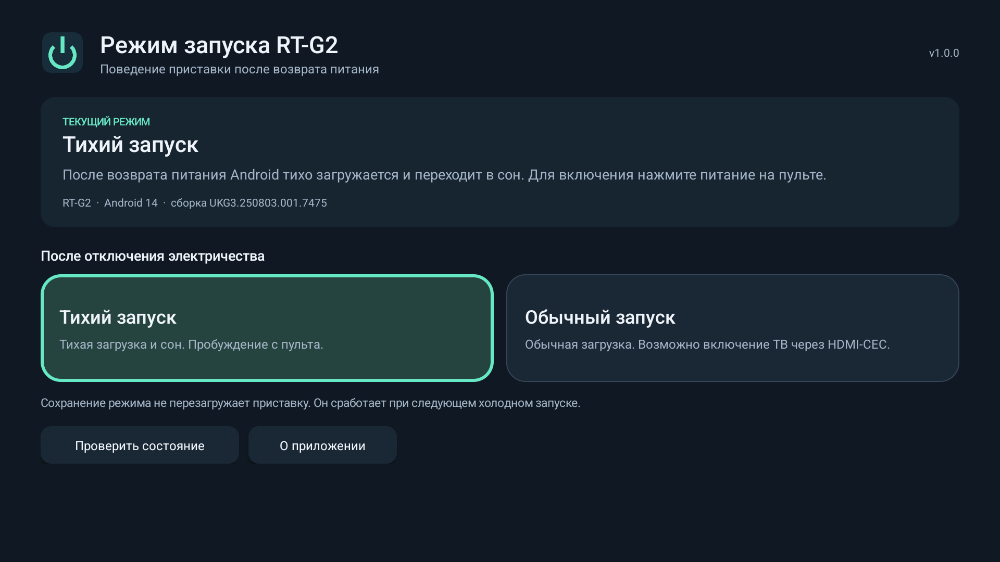

# Режим запуска RT-G2

Приложение для Android TV с двумя вариантами поведения **RockTek RT-G2 после возврата электричества**.



- **Тихий запуск:** Android тихо загружается и переходит в сон. Включение с пульта и обычное пробуждение телевизора через CEC сохраняются.
- **Обычный запуск:** возвращается исходный сценарий загрузки; приставка может включить ТВ через HDMI-CEC.
- Иконка и баннер для меню Android TV, русский и английский интерфейс, управление пультом.
- Не нужны root, постоянный ADB или Интернет. Нет фоновой службы и автоматической перезагрузки.

Тихий запуск всё равно запускает процессор и загружает Android, затем приставка засыпает. Это не аппаратный запрет включения при подаче питания.

## Совместимость

Версия 1.0 проверена только на **RT-G2 / SEI804RT / YYJ, Android TV 14, прошивка 7475** с fingerprint:

```text
RockTek/SEI804RT/YYJ:14/UKG3.250803.001/7475:user/release-keys
```

Также проверяется точное содержимое `switch_bootmode`: допускаются только известные исходный и изменённый сценарии. На других прошивках и при неожиданном содержимом запись заблокирована. Совпадения модели или процессора недостаточно для добавления поддержки.

## Установка

1. Скачайте APK из [последнего релиза](https://github.com/ravextech/rtg2-power-control/releases/latest).
2. Передайте файл на приставку и откройте установщиком APK либо установите через ADB:

   ```sh
   adb install -r RTG2-Power-Control-1.0.0.apk
   ```

3. Откройте **«Режим запуска RT-G2»** в списке приложений.
4. Выберите режим и подтвердите **«Сохранить режим»**.

Приставка не перезагружается при сохранении. Изменение действует при следующем холодном запуске. После установки можно отключить ADB: само приложение работает без него.

## Проверка и откат

Выключите телевизор, отключите питание RT-G2 на 10 секунд, подключите обратно и дождитесь завершения загрузки. В тихом режиме телевизор должен остаться выключенным. Затем проверьте включение с пульта.

Чтобы отменить изменение, откройте приложение и выберите **«Обычный запуск»**. Перед каждой записью проверяется прошивка и текущий сценарий, перед первой записью сохраняется исходный сценарий, затем результат проверяется чтением.

**Удаление приложения не отменяет выбранный режим.** Сначала верните обычный запуск, если нужно полностью убрать изменение. Сохраните APK для повторной установки и отката. Если при сохранении появилась ошибка, оставьте питание подключённым и разберитесь с ней до перезагрузки. После OTA прошивка может сбросить настройку или стать несовместимой с текущей версией приложения.

На физической RT-G2 с прошивкой 7475 профиль проверен 19 ноября 2026 года: после возврата питания ТВ остался выключенным, приставка перешла в сон, пульт разбудил приставку и ТВ, правка сохранилась. Эти результаты относятся к проверенному устройству и прошивке.

## Что меняется

Через штатную службу Amlogic `SystemControl` приложение записывает одну переменную окружения загрузчика — `ubootenv.var.switch_bootmode`. В ветку `cold_boot` добавляются команды из штатной ветки `quiescent`, передающие Android параметр тихой загрузки. Остальные ветки сохраняются. APK не перепрошивает разделы и не меняет SELinux.

Подробности, тесты, сборка и ссылки на исходные исследования — в [README на английском](README.md). Исходники можно собрать с Python 3.9+ и JDK 17+ на macOS или x86-64 Linux:

```sh
python3 tools/build.py --test-only
python3 tools/build.py
```

Обычная сборка и артефакт GitHub Actions подписываются отладочным ключом. Для установки и распространения используйте подписанный APK из Releases.

Лицензия исходного кода и оригинальной графики: [MIT](LICENSE). Это независимый проект, не связанный с RockTek или SEI Robotics.
